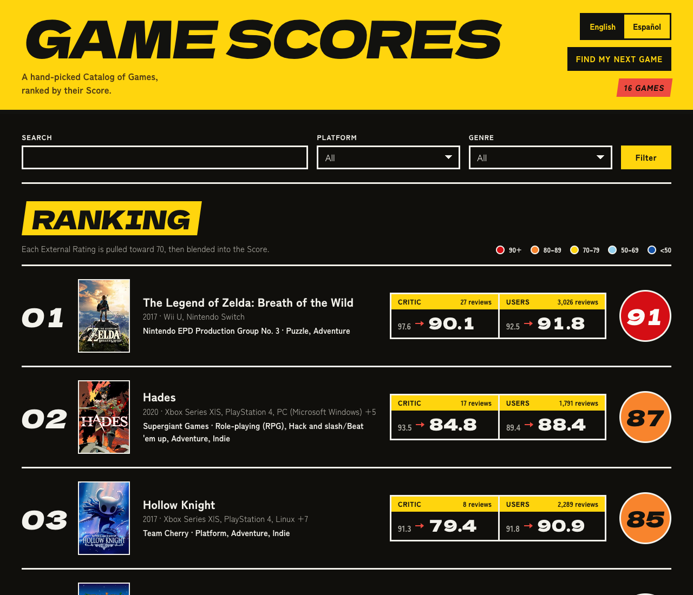
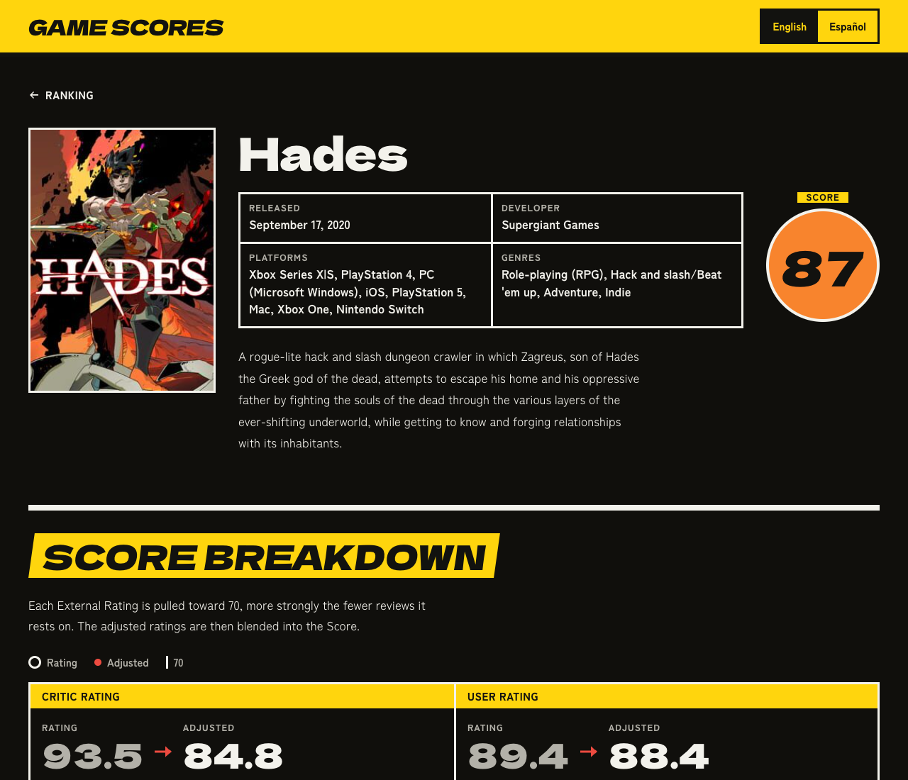
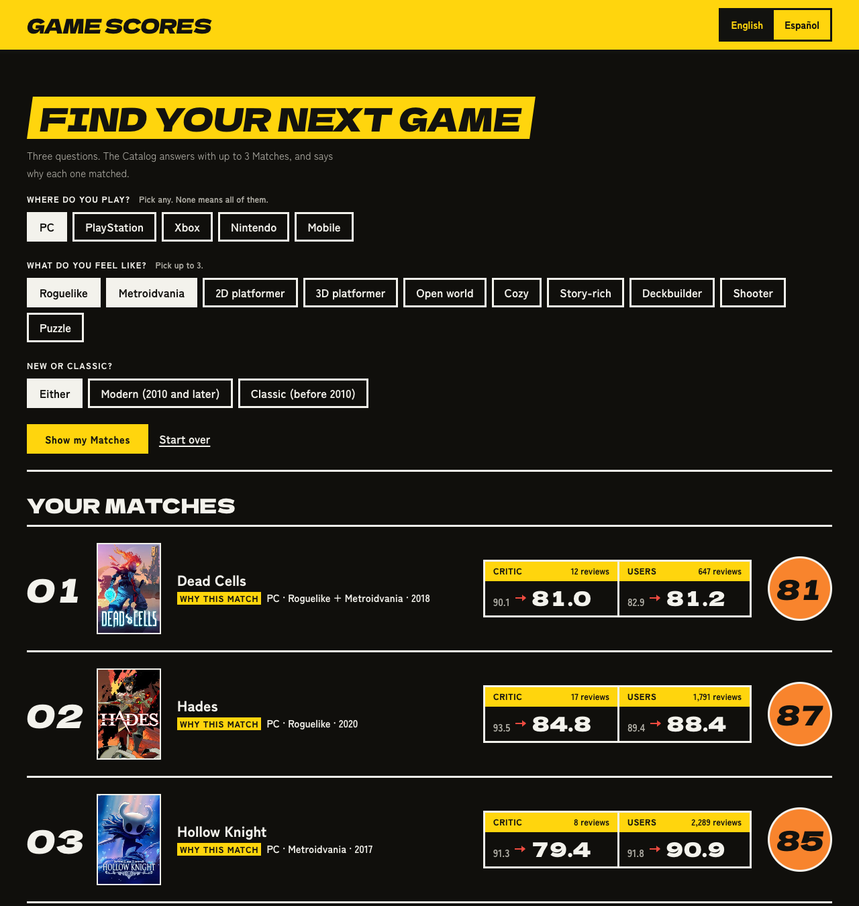

# Game Scores

A hand-picked Catalog of Games, ranked by the site's own Score, in English and Spanish.

**Live:** https://game-scores-rho.vercel.app



Aggregators show a number; this site shows the working. Each External Rating from IGDB is pulled
toward a baseline of 70, more strongly the fewer reviews it rests on, and the adjusted critic and
user ratings are blended 50/50. Every Game page prints the raw ratings, review counts, adjusted
values and each one's share. The formula lives in `lib/catalog.ts`.

Built with Next.js (App Router), TypeScript and plain CSS. A Google Sheet is the database
(`docs/adr/0001`). See `GLOSSARY.md` for vocabulary, `.scratch/game-scores/spec.md` for the spec
[`ROADMAP.md`](ROADMAP.md) for what's next, and
[`docs/how-i-built-this.md`](docs/how-i-built-this.md) for the process, in English and Spanish.

## Screens

| Game page and Score Breakdown | Quiz and Matches |
| --- | --- |
|  |  |

## Run

```sh
npm install
npm run dev        # http://localhost:3000
npm test           # Vitest: the Catalog read seam
npm run typecheck
npm run build
```

Check the Sheet connection (prints tabs, header and Game names, no secrets):

```sh
node --env-file=.env.local scripts/check-sheet.mjs
```

## Environment variables

Put these in `.env.local` locally and in the Vercel project settings for deploys:

| Variable | Value |
| --- | --- |
| `GOOGLE_SERVICE_ACCOUNT_EMAIL` | The service account's email. Share the Sheet with it as an editor. |
| `GOOGLE_PRIVATE_KEY` | The service account's private key, on one line with newlines escaped as `\n`. |
| `GOOGLE_SHEET_ID` | The ID from the Sheet's URL: `docs.google.com/spreadsheets/d/<ID>/edit`. |
| `IGDB_CLIENT_ID` | Client ID of a Twitch app (dev.twitch.tv/console/apps, OAuth redirect `https://localhost`; Twitch rejects plain http). Used only on the server. |
| `IGDB_CLIENT_SECRET` | That Twitch app's client secret. The server trades both for an IGDB app access token and caches it until it expires. |
| `ADMIN_PASSWORD` | The password for `/admin`. It also signs the 30-day session cookie, so changing it logs everyone out. |

## The Sheet

One tab named `Games`, one row per Game. The header row is exactly:

```
igdb_id, slug, name, cover_url, release_date, platforms, genres, developer, description, critic_rating, critic_count, user_rating, user_count, last_synced
```

- Format every column as **Format → Number → Plain text**. Otherwise Sheets turns a typed
  `2020-01-01` into a date displayed as `1/1/2020`, and the row is rejected.
- `release_date` is `YYYY-MM-DD`; `last_synced` is an ISO datetime.
- `slug` is lowercase kebab-case (`the-game-2020`), unique; `igdb_id` is unique.
- `cover_url` is an https URL (IGDB's image CDN) or empty.
- `platforms` and `genres` are comma-separated.
- Ratings are 0–100; counts are whole numbers. A rating with an empty or zero count is ignored.
- `cover_url` may be empty (a placeholder is shown).
- The Score is computed, never stored. Invalid rows are left off the site.

The site reads the Sheet at most every 10 minutes (cache tag `catalog`), so hand edits take up to
10 minutes to appear.

## Deploy

Vercel's free Hobby plan. Import the repo in Vercel (framework preset: Next.js, production branch
`main`), add the six environment variables, deploy. Every push to `main` deploys; other branches
get preview URLs. The admin page is at `/admin`.

GitHub Pages can't host this: it serves static files only, and the site needs a server for the
Sheet credentials, IGDB, the admin actions and the locale redirect.
